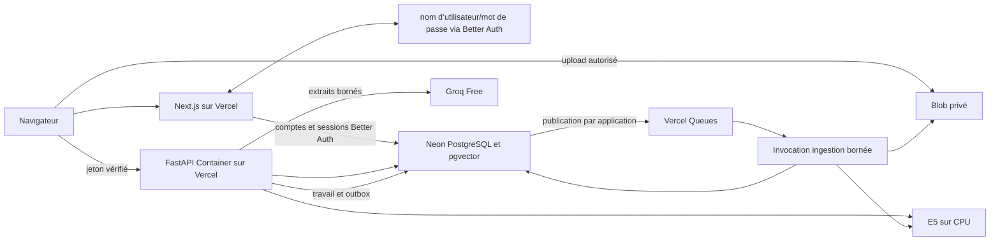

# Étape 0 — Cadrage et faisabilité Vercel

Date : 11 octobre 2026. Solution retenue : **Groq Free**.
Contrainte actualisée : **budget total de 0 €**, projet personnel destiné au CV,
sans objectif commercial. [ADR 0002](decisions/0002-budget-zero-et-authentification.md)
remplace les estimations avec réserve VCR/domaine et le choix initial Clerk.

**Statut : étape 0 validée le 11 octobre 2026 sur le périmètre approuvé par le porteur.**
L'appel Groq Free réel et l'exécution FastAPI/E5/Groq sur Vercel sont certifiés.
Le porteur a fourni une clé privée, renouvelé la connexion CLI Vercel et confirmé
le niveau **Free** dans Groq Settings → Billing. Le projet `assistant-rag` est
créé sur Vercel Hobby ; les essais sur sa Preview `fra1` réussissent.
Le porteur demande de valider le travail nécessaire maintenant et de traiter
le reste au moment du besoin. L'étape 0 est donc clôturée avec les preuves
disponibles ; base, Blob privé, Queues, identité et budget réel seront qualifiés
aux étapes concernées (§ 8). L'étape 1 peut démarrer. Aucun passage à un forfait
payant ni ajout de moyen de paiement n'a été effectué.

## 1. Décisions et architecture

Décision détaillée : [ADR 0001](decisions/0001-groq-et-architecture-v1.md).

| Élément | Choix de cadrage | Preuve disponible |
| --- | --- | --- |
| LLM | Groq Free, `openai/gpt-oss-120b` | Free confirmé dans Billing ; appels réels local et Vercel réussis |
| Embeddings | `intfloat/multilingual-e5-small`, CPU, 384 dimensions | Chargement, encodage, normalisation et recherche testés localement et sur Vercel |
| Web/API | Next.js + FastAPI, Vercel Services | FastAPI déployé dans un service ; Next.js reste à développer |
| Runtime Python | Container, poids dans l'image à la construction | Image OCI acceptée, exécution `fra1`, mémoire et temps de la fixture mesurés |
| Identité | Better Auth dans Next.js, nom d’utilisateur/mot de passe, sessions dans Neon Free | Choix à 0 € ; intégration étape 2, aucun domaine acheté ni service d'e-mails |
| Base | Neon Free, PostgreSQL/pgvector, pool | Choix de fournisseur ; provisionnement et SQL réels en attente |
| Fichiers | Vercel Blob privé, upload direct | Parcours documenté ; réservation/finalisation à implémenter |
| Ingestion | Vercel Queues + état/outbox PostgreSQL | Offre documentée ; livraison/reprise à vérifier |



L'outbox n'est pas un déclencheur PostgreSQL appelant directement Vercel :
l'application publie puis réconcilie les événements non confirmés. La file ne
contient que des identifiants, jamais les fichiers ou passages. L'ingestion
contrôle génération, propriétaire et suppression avant toute publication atomique.
Seule une preview protégée avec corpus fictif sera utilisée avant validation
de l'authentification. La V1 finale reste publique et authentifiée.

## 2. Groq Free et capacité du pilote

Le modèle retenu est classé comme modèle de production par Groq. L'offre Free
ne nécessite pas de passer au niveau Developer payant ; ce changement requiert
un moyen de paiement. Aucun fallback payant ni outil intégré tarifé n'est prévu.
Sources : [modèles](https://console.groq.com/docs/models),
[facturation](https://console.groq.com/docs/billing-faqs).

Les limites Free publiées pour ce modèle sont 30 requêtes/minute,
1 000/jour, 8 000 tokens/minute et 200 000/jour, à l'échelle de l'organisation.
Les en-têtes des appels réels donnent 1 000 requêtes/jour et 8 000 tokens/minute.
Le niveau Free est confirmé par le porteur dans Billing ; l'API n'expose pas ce
niveau et ne certifie pas seule la facturation. Les autres plafonds restent ceux
de la documentation, à surveiller dans le compte. Un dépassement produit `429` ;
respecter `Retry-After`.
Source : [quotas Groq](https://console.groq.com/docs/rate-limits).

Budget initial **proposé pour le pilote**, à abaisser si le compte impose moins :

| Garde-fou applicatif | Valeur initiale |
| --- | --- |
| Budget d'entrée total par tentative | 2 500 tokens, prompt/question/historique/extraits compris |
| Budget de completion | 600 tokens, raisonnement inclus ; effort `low` |
| Par utilisateur | 10 tentatives/jour |
| Global | 50 tentatives/jour, 2/minute, une génération simultanée |
| Réservations globales de tokens | 6 200/minute et 155 000/jour maximum sur ces budgets |
| Timeout génération | 60 secondes ; au maximum deux retries si délai et réservations le permettent |

Calcul prudent : `(2 500 + 600) × 50 = 155 000` tokens/jour, soit 77,5 % du
plafond publié. Un retry compte comme une tentative et réserve un nouveau budget.
Ce plafond ne promet donc pas 50 réponses réussies. Compter avec le tokenizer
compatible du LLM ; réconcilier `usage`, garder une marge pour autres usages du
compte et ne pas exploiter le contexte maximal de 131 072 tokens dans le pilote.
Le budget de 600 tokens devra être augmenté seulement après examen des réponses
tronquées et révision des plafonds. Une réponse interrompue n'est pas un succès.

Les compteurs et réservations atomiques seront stockés en PostgreSQL, avec
expiration des verrous ; aucun compteur process-local comme contrôle global.
En cas d'épuisement, présenter une erreur de quota, sans changer d'offre.

Groq indique ne pas conserver les requêtes d'inférence par défaut, avec exceptions
pour fiabilité/abus pouvant aller jusqu'à 30 jours. Activer Zero Data Retention
dans les contrôles du compte avant des documents personnels ; désactiver les
fonctionnalités persistantes. Les données retenues sont localisées aux États-Unis.
Informer l'utilisateur de la transmission des extraits ; ce document ne valide
pas les conditions contractuelles de son futur compte.
Source : [traitement des données Groq](https://console.groq.com/docs/your-data).

## 3. Résultats locaux mesurés

Environnement : Ubuntu WSL, Python 3.10.12, Torch 2.14.1 CPU,
Sentence Transformers 6.1.0, un thread de calcul. Révision E5 figée :
`614241f622f53c4eeff9890bdc4f31cfecc418b3`.
Les préfixes `query: ` / `passage: ` et la normalisation suivent la
[fiche officielle du modèle](https://huggingface.co/intfloat/multilingual-e5-small).

| Contrôle | Résultat du dernier essai |
| --- | --- |
| Vecteurs | 22 × 384, normes égales à 1 à la tolérance 1e-5 |
| Longueur du modèle / des passages d'essai | 512 tokens / 51 maximum |
| Chargement avec poids déjà en cache | 3,344 s |
| Encodage des 22 passages, lots de 4 | 0,572 s |
| Pic mémoire du processus Linux | 1 063,9 Mio |
| Encodage + classement d'une question, médiane / p95 | 30,15 ms / 51,23 ms |
| Recall@5 sur les questions répondables de développement | 100 %, moyenne sur 17 cas |
| Questions finales évaluées | 0 sur 10 |

Preuve détaillée : [embeddings-step0.json](../evaluation/reports/embeddings-step0.json).
Le premier téléchargement et chargement a pris environ 35,6 s ; le résultat
ci-dessus utilise le cache. Les poids uniques font environ 449 Mio ; le cache
incluant tokenizer/configuration environ 470 Mio. L'environnement d'essai occupe
environ 1,4 Gio avant ce cache.

**Portée limitée :** passages canoniques très courts, produit scalaire en mémoire
sur vecteurs normalisés, sélection documentaire appliquée avant top-k. Le résultat
ne certifie ni découpage 300/50, ni PostgreSQL, ni long document, ni isolation entre
utilisateurs, ni citations/génération. Aucun seuil d'abstention n'a été calibré.
Les trois questions hors corpus de développement ont des scores de recherche,
mais aucune réussite d'abstention n'est revendiquée. Les temps ne sont pas des
performances Vercel ni les objectifs p95 de la V1.

Le probe Groq local a réussi : HTTP 200, 149 tokens d'entrée et 48 de completion
(197 au total), 0,400 s côté client, réponse factuellement conforme à la fixture
et référence `[S1]` valide. Le rapport local est ignoré par Git ; les essais
Vercel ci-dessous fournissent une preuve partageable sans clé ni réponse brute.
Le contrôle de cette fixture ne remplace pas l'évaluation humaine des citations.

### 3.1 Exécution réelle sur Vercel

- Projet : `assistant-rag`, ID `prj_YRjALOFSlBmLPqv4n3cJa1CRSV0W`.
- Espace : `danii15321s-projects`, plan Hobby ; runtime Frankfurt `fra1`.
- [Preview HTTPS](https://assistant-lkmtm142p-danii15321s-projects.vercel.app).
- [Déploiement READY](https://vercel.com/danii15321s-projects/assistant-rag/CJPLW6bD9ExEQ4GD8ahZjtSdPLZt), ID `dpl_CJPLW6bD9ExEQ4GD8ahZjtSdPLZt`.
- Image VCR Linux amd64 : **672 534 414 octets compressés (641,38 Mio)** ;
  construction distante de 2 min 25 s. Image locale non compressée :
  1 980 817 102 octets ; ces deux mesures ne sont pas interchangeables.

| Contrôle de la fixture sur Preview | Résultat |
| --- | --- |
| Santé / génération sans jeton applicatif | HTTP 200 / HTTP 401, après accès Vercel autorisé |
| E5, deux passages courts | 384 dimensions, normes unitaires, bon passage retrouvé |
| Première invocation du second essai, modèle non chargé | Chargement 8,684 s ; total applicatif 9,313 s |
| Invocation suivante, modèle chargé | Chargement 0 s ; encodage/recherche 0,072 s ; total 0,435 s |
| Pic RSS du processus, second essai | 869,6 Mio |
| Groq sur chacune de ces deux invocations | HTTP 200 ; 131 + 50 = 181 tokens ; arrêt `stop` |
| Réponse et références | Éléments attendus présents ; uniquement `[S1]` |

Le premier essai séparé a mesuré 9,908 s de chargement, 10,355 s au total et
870,2 Mio de pic RSS. Preuves : [premier essai](../evaluation/reports/vercel-step0-initial.json),
[essai froid/chaud et empreintes des sources](../evaluation/reports/vercel-step0.json),
[métadonnées du déploiement et de l'image](../evaluation/reports/vercel-deployment-step0.json).

Les temps partent du handler applicatif : ils excluent démarrage du conteneur,
routage, protection Vercel et lancement de la CLI. Deux invocations ne constituent
pas un benchmark p95. Aucune mesure de lots de quatre passages de 300 tokens,
concurrence, imports, base, stockage ou file n'est revendiquée.

La protection Vercel est conservée : un navigateur sans session Vercel arrive
sur la connexion. Les contrôles HTTP utilisent `vercel curl`, qui autorise
l'accès à la Preview du projet lié ; `/probe` exige aussi un jeton serveur.
Les secrets sont des variables **Secret Preview** uniquement. Aucun document
personnel ni question arbitraire n'est accepté. Ce jeton de qualification ne
remplace pas l'authentification utilisateur exigée en V1.

Le premier envoi sur ce projet neuf a pris la cible Production par défaut.
Un second envoi avec `--target preview` a fixé explicitement la cible des essais.
Le premier déploiement reste protégé et n'a aucun secret de génération en
Production ; il n'a pas été utilisé pour certifier l'appel. Toujours préciser
la cible lors des prochains déploiements. Guide : [prototype](../probes/vercel/README.md).

## 4. Contraintes Vercel et identité

Les Functions Hobby disposent de 2 GB et d'une durée maximale de 300 s avec Fluid
Compute. Le bundle Python standard est limité à 500 MB ; une requête/réponse de
fonction à 4,5 MB. Sources : [limites Functions](https://vercel.com/docs/functions/limitations),
[runtime Container](https://vercel.com/docs/functions/runtimes/container).

Le poids local conduit à sélectionner Container plutôt que le bundle Python
standard. L'image du prototype est acceptée sur le compte Hobby : son poids
compressé de 672,5 MB est inférieur aux plafonds image et couche. VCR autorise
15 GB par image compressée, 2 GB par couche. Sa grille générale affiche
0,10 USD/GB, mais la comparaison des plans inclut **10 GB de VCR sur Hobby**.
Les deux images du prototype occupent environ **1,35 GB**, dans cette inclusion
avant prise en compte des autres projets du compte. Viser au plus 5 GB pour ce
projet ; aucun dépassement payant. Sources :
[limites VCR](https://vercel.com/docs/container-registry/limits-and-pricing),
[inclusions Hobby](https://vercel.com/pricing).

Précharger le modèle dans l'image et garder un seul encodeur par instance, sans
processus Uvicorn multiples dupliquant les poids. Viser un pic inférieur à 1,5 Gio
sur des lots de 4 passages de 300 tokens, une invocation d'ingestion de moins de
240 s et des points de reprise. Ces valeurs sont des critères à tester ; le pic
local de 1,04 Gio sur de courts textes ne prouve pas cette marge. Aucune tâche
critique ne dépend de l'activité d'une instance après la réponse.

Les 20 Mio d'un fichier passent directement du navigateur à Blob privé après
autorisation. FastAPI ne reçoit que la réservation et les métadonnées puis lit
l'objet privé pour l'extraction. Ne pas exposer des URLs publiques ni faire passer
le fichier dans un POST vers une Function. Source :
[uploads clients Blob](https://vercel.com/docs/vercel-blob/using-blob-sdk#client-uploads).

Queues facture les opérations, inclut le premier million sur Hobby et garantit
une livraison à traiter de façon idempotente. La rétention par défaut est 24 h,
maximale 7 jours ; configurer le délai de visibilité selon chaque lot et le
renouveler avant expiration. Vérifier aussi la compatibilité du callback Python
Container en preview. Source : [prix et limites Queues](https://vercel.com/docs/queues/pricing).

Services ajoute des requêtes internes et du transfert aux coûts des Functions,
avec un million de requêtes de service incluses sur Hobby. Ne pas considérer un
binding privé comme une autorisation de données.
Source : [Services](https://vercel.com/docs/services/pricing).

Better Auth est retenu dans Next.js, avec nom d’utilisateur/mot de passe et sessions dans Neon Free.
Le plugin JWT fournit les jetons et JWKS vérifiés par FastAPI. Aucune primitive
d'authentification maison, aucun envoi d'e-mails. Le porteur a retenu
`prenom.nom` / mot de passe à l'étape 2 ; voir ADR 0003. La récupération automatique
est hors V1. L'URL de production est `vercel.app`, avec origine explicitement
autorisée et secret distinct ; aucun domaine acheté. Sources :
[Better Auth username](https://better-auth.com/docs/plugins/username),
[JWT/JWKS](https://better-auth.com/docs/plugins/jwt).

## 5. Limites applicatives et budget

Finalité confirmée : projet CV personnel non commercial, budget strict de 0 €.
Hypothèse de démonstration : cinq comptes actifs,
100 nouveaux fichiers et 1 000 générations par mois, fichiers de 5 Mio en moyenne.
Ce sont des hypothèses de dimensionnement, pas une consommation déjà observée.

| Ressource | Plafond applicatif initial |
| --- | --- |
| Fichier | 20 Mio ; PDF textuel/DOCX/TXT |
| Compte | 50 documents, 100 Mio d'originaux, 10 000 passages |
| Global | 100 documents, 600 Mio d'originaux, 20 000 passages |
| Extraction par document | 1 million de caractères, 500 pages PDF, temps et mémoire bornés |
| Indexation | Lots de 4 embeddings ; un import simultané pour le pilote |
| Base | Arrêter les nouveaux imports à 600 Mio réellement occupés |

Les limites s'appliquent simultanément : un compte peut atteindre sa capacité
en octets avant 50 documents. Réserver les octets pendant les uploads ; inclure
fichiers abandonnés et environnements de test dans la surveillance globale.
Revoir ces plafonds après mesure des index, historiques et sauvegardes.

Pour 20 000 vecteurs float32 de 384 dimensions, les seules coordonnées occupent
30,72 MB. Avec 2 KB de texte moyen par passage, ajouter environ 40 MB avant
overhead PostgreSQL, métadonnées, historiques et index. La capacité réelle sera
mesurée via taille DB ; ce calcul n'est pas une garantie d'espace final.

| Poste | Offre gratuite retenue | Budget autorisé |
| --- | --- | --- |
| Groq Free | Quotas ci-dessus, aucune activation Developer | 0 € |
| Vercel Hobby | Hébergement personnel non commercial, compute et transfert inclus dans les limites du plan | 0 € |
| VCR Hobby | 10 GB inclus ; deux images du prototype ≈ 1,35 GB, plafond projet cible 5 GB | 0 € |
| Blob Hobby | Stockage privé dans les quotas inclus ; blocage au dépassement | 0 € |
| Queues et Services | Opérations/requêtes dans les inclusions Hobby, compute compté aussi | 0 € |
| Neon Free | 1 GB de base et 100 CU-h/mois publiés par projet ; quotas réels à relever | 0 € |
| Better Auth avec identifiants locaux | Bibliothèque open source dans Next.js ; utilise la base et le compute gratuits | 0 € |
| Domaine et e-mails | URL `vercel.app` ; nom d’utilisateur/mot de passe sans envoi d'e-mails applicatifs | 0 € |

Sources : [Hobby Vercel](https://vercel.com/docs/plans/hobby),
[grille des plans Vercel, dont VCR](https://vercel.com/pricing),
[Blob](https://vercel.com/docs/vercel-blob/usage-and-pricing),
[nouvelle capacité Neon](https://neon.com/blog/neon-free-plan-1-gb-per-project),
[allocation compute Neon](https://neon.com/blog/neon-backend-is-ga).
Les tarifs unitaires payants affichés par les fournisseurs ne sont pas des
dépenses autorisées ; ce projet reste exclusivement sur les offres gratuites.

**Enveloppe autorisée : 0 € au total**, en développement et en démonstration.
Les anciennes réserves VCR et domaine sont supprimées. Aucun forfait/add-on
payant, achat de domaine, activation de facturation, moyen de paiement ajouté
ou essai temporaire nécessitant un abonnement. Vérifier à chaque intégration
que le plan est gratuit et que le compte dispose des inclusions nécessaires.
Les quotas sont partagés avec les autres usages du compte ; les alertes
d'usage complètent les limites applicatives.

Au quota, suspendre l'opération et informer de sa disponibilité ultérieure,
sans acheter de capacité ni passer à Pro. Hobby limite la consommation ;
Blob précise qu'un dépassement entraîne une indisponibilité, sans frais
supplémentaires. Ce comportement est accepté pour la démonstration CV.
Sources : [règles Hobby](https://vercel.com/docs/plans/hobby),
[Hobby Blob](https://vercel.com/docs/vercel-blob/usage-and-pricing).

Suivre CPU, mémoire provisionnée, transferts, stockage réel et opérations dès la
preview ; points d'alerte à 50 %, 75 % et 90 % des inclusions. Garder une marge
pour les démarrages à froid et les previews. Les limites logicielles ne remplacent
pas les contrôles de coût du compte. Supprimer les previews obsolètes uniquement
selon une politique conservant le rollback, pour limiter le stockage d'images.

## 6. Corpus et commandes d'essai

[Corpus Iris](../evaluation/README.md) : quatre documents exploitables dans les
trois formats, trois fichiers négatifs, 22 passages, 30 annotations. Répartition
20 développement / 10 finale. Contrôles d'extraction et d'empreinte réussis ; PDF
inspectés visuellement. Contrôle visuel DOCX en attente : LibreOffice absent,
échec explicite du renderer ; extraction et repères vérifiés.

Les [scripts de cadrage](../scripts/step0/) sont isolés du futur code métier.
Leur installation et exécution sont décrites dans le README d'évaluation.
Pour reproduire l'appel Groq, utiliser une clé d'un compte Free depuis la
[console Groq](https://console.groq.com/keys), conservée uniquement dans
`.env.local` (ignoré), sans la coller dans le chat ni dans `.env.example`.

```bash
cd /home/daniel/assistant-rag
python3 scripts/step0/probe_groq.py --live
```

Sans `--live`, aucun appel ; sans clé, code 2 ; un échec fournisseur ou contrôle
de réponse échoué donne code 1. Un succès donne code 0. Le rapport local ignore
clés, prompts, extraits et réponse brute. Il ne démontre pas à lui seul la gratuité :
vérifier simultanément le niveau Free et l'absence de facturation dans la console.

## 7. Critères de clôture de l'étape 0 — validés

| Vérification | Action et preuve attendue | État |
| --- | --- | --- |
| Cadrage | Décisions, architecture cible, limites et budget prévisionnel | Livré |
| Corpus initial | Documents fictifs, repères et annotations de développement/validation | Livré ; extraction et empreintes contrôlées |
| Groq réel | Un appel gratuit sourcé réussi ; modèle, usage, limites du compte et délai consignés | Validé ; Free confirmé dans Billing et appels HTTP 200 |
| Projet cible | Connexion Vercel renouvelée, projet Assistant RAG, plan/région connus | Validé ; Hobby, Preview `fra1` |
| Image Python | Construire FastAPI + E5 embarqué, poids OCI et couches sous limites | Validé pour le prototype ; image compressée 641,38 Mio |
| Exécution Vercel | Importer les dépendances, encoder sur preview ; mémoire et durées froid/chaud mesurées | Validé sur fixture courte ; charge représentative encore à tester |

La clôture porte sur le cadrage et la faisabilité initiale prouvée par le
prototype synthétique. Les mesures et rapports conservés ne revendiquent pas
l'implémentation des composants suivants. La demande du porteur remplace
l'ancienne condition qui exigeait leur qualification pour clôturer l'étape 0.

## 8. Contrôles reportés au moment du besoin

| Composant ou contrôle | Quand le réaliser | Preuve attendue |
| --- | --- | --- |
| PostgreSQL/pgvector puis Neon | Étape 1 en local ; Neon au prochain jalon Vercel | Extension et migrations testées, persistance après recréation locale ; connexion poolée et persistance après redéploiement lors de la qualification cloud |
| Identité et isolation | Étape 2 — avant ouverture des parcours privés | Better Auth avec identifiants locaux configuré, sessions et JWT vérifiés, deux comptes isolés |
| Blob privé et upload 20 Mio | Étape 3 — import documentaire | Objet privé, upload direct autorisé, finalisation et accès par propriétaire |
| Queues et consommateur Python | Étape 3 — ingestion durable | Livraison, idempotence et reprise sans dépendance à une instance permanente |
| Mémoire/temps sur lots de 300 tokens et documents longs | Étape 4 — indexation représentative | Mesures par lot, invocations bornées et points de reprise |
| Quotas partagés et données transmises à Groq | Étape 6 — génération sur documents utilisateurs | Limiteur distribué, budgets de tokens, réglages de rétention et information utilisateur |
| URL et identité de production | Étape 8 — préparation de la publication | URL `vercel.app` et origine Better Auth contrôlée ; parcours de production vérifié |
| Budget de 0 € et quotas du compte | À chaque provisionnement/intégration ; bilan complet à l'étape 8 | Plans gratuits, inclusions disponibles, aucune dépense et suspension au quota documentés |
| Rendu visuel DOCX du corpus | Étape 3 — validation du parseur DOCX | Comparaison du document affiché avec texte et repères extraits |

Ces contrôles sont planifiés et ne bloquent plus le démarrage de l'étape 1.
Depuis la demande du 11 octobre 2026, les développements et tests se font en local.
Les qualifications cloud ci-dessus sont regroupées à un jalon Vercel ultérieur ;
aucun déploiement n'est déclenché à chaque implémentation.
Ils deviennent des critères d'acceptation lorsque le composant est utilisé.
L'authentification, la confidentialité et l'hébergement public sur Vercel restent
obligatoires pour la livraison V1. Aucun service supplémentaire n'est provisionné
dans le cadre de cette clôture.
