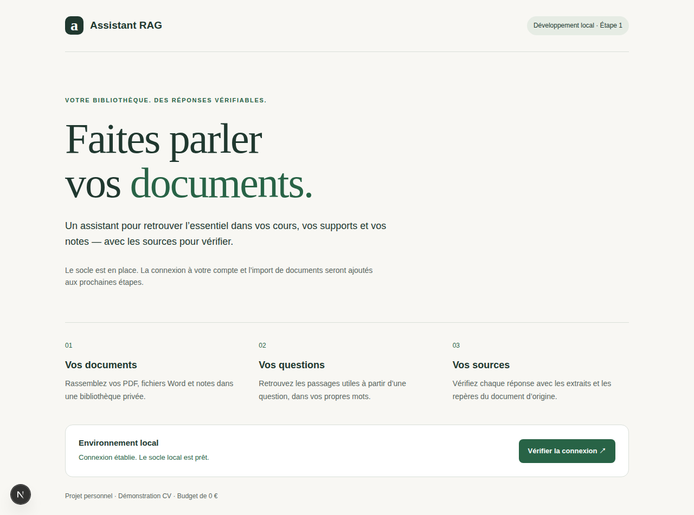
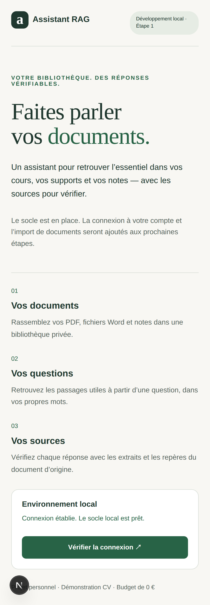

# Étape 1 — Socle local validé

**Date :** 11 octobre 2026. **Périmètre :** développement et tests locaux,
conformément à la cadence demandée par le porteur. Aucun déploiement Vercel,
provisionnement cloud ou appel LLM pendant cette étape.

## Ce qui est livré

- Next.js 16.4 / React 19.3, App Router, TypeScript strict, page française responsive.
- FastAPI 0.143, API minimale, frontières routes/services/repository.
- PostgreSQL 16.15 et pgvector 0.8.7 dans un volume persistant.
- Migration Alembic `0001_vector`, appliquée avant le démarrage de l'API.
- Docker Compose avec ports locaux, contrôles de santé, rechargement des sources,
  conteneurs applicatifs sans privilèges root et images fixées par digest.
- Configuration privée générée sans toucher à la clé Groq de `.env.local`.
- Réécriture de même origine `/api/v1/*` vers FastAPI ; variables DB côté serveur.
- Suites Python et Chromium, commandes et [guide local](developpement-local.md).

Les tables métier et routes documentaires arriveront avec leurs étapes.
L'authentification Better Auth avec identifiants locaux est la prochaine étape ; elle n'est pas
encore implémentée. Le prototype et `vercel.json` de l'étape 0 sont conservés.

## Validation exécutée

La commande `bash scripts/local/check.sh` se termine avec le code **0**.

| Contrôle | Résultat |
| --- | --- |
| API : vivant sans base, prêt après migration, indisponibilité, erreurs sans secrets, absence de cache | 5 tests réussis |
| PostgreSQL isolé : migration, recherche cosine sur vecteurs de 384 dimensions, réapplication, retour arrière sur base vide | 2 tests réussis |
| Navigateur : connexion réelle, base indisponible/reconnexion, erreur réseau, chacun sur bureau et mobile | 6 tests réussis |
| Ruff et format Python, mypy strict | Réussis |
| ESLint et TypeScript strict | Réussis |
| Compilation de production Next.js dans un cache séparé | Réussie |
| Recréation du conteneur PostgreSQL en conservant le volume | Vecteur synthétique inchangé, fixture nettoyée |
| Frontend, API via Next.js et liveness après recréation | HTTP 200 |
| Secrets dans sources et artefacts générés ; permissions des configurations | Aucune fuite détectée ; `.env` et `.env.local` en `0600` |
| Sources qualifiées de l'étape 0 | Quatre empreintes SHA-256 conservées |

Les premiers tests API échouaient avant implémentation. Les tests navigateur ont
ensuite révélé le clic avant hydratation et l'origine interne de développement
non autorisée : le bouton reste désactivé jusqu'à son hydratation et seul le nom
interne `frontend` a été ajouté aux origines de développement. Le volume de
cache Next.js est initialisé avec le propriétaire du processus applicatif.

Les tests PostgreSQL recréent seulement le schéma de `assistant_rag_test`,
indépendant de `assistant_rag`. Le contrôle de persistance recrée uniquement
le conteneur `db` de ce projet ; il n'efface pas le volume et ne touche pas aux
autres projets Docker. Les trois services restent démarrés en local.

Les versions, résultats et empreintes sont dans le
[rapport reproductible](../evaluation/reports/foundation-step1.json).

## Limites déclarées

`npm audit --omit=dev` ne signale aucune vulnérabilité. L'audit complet remonte
**5 entrées High** dans la chaîne de lint `eslint-config-next` → `fast-glob` →
`micromatch` → `braces`, toutes rattachées à la
[même alerte sans correctif publié](https://github.com/advisories/GHSA-vfj7-8cjw-p6xm).
Cette chaîne appartient à l'outillage de développement. Elle reçoit les motifs
de fichiers de la configuration du projet, pas les documents des utilisateurs.
Cette observation de périmètre ne constitue pas un audit de sécurité complet.

ESLint 9 reste nécessaire à la compatibilité déclarée d'`eslint-plugin-react`
dans la configuration Next.js actuelle ; cette branche n'est plus maintenue.
Ne pas forcer un contournement des dépendances ni rétrograder Next.js pour
effacer l'alerte. Réexaminer cet outillage lors de la disponibilité d'une
configuration compatible et corrigée, avant la publication de la V1.

Neon, callbacks OAuth publics, upload Blob, Queues, HTTPS et persistance après
redéploiement restent à qualifier au jalon Vercel regroupé. Les résultats locaux
ne certifient pas ces composants cloud. Le budget de 0 € demeure obligatoire.

## Captures du parcours réel

